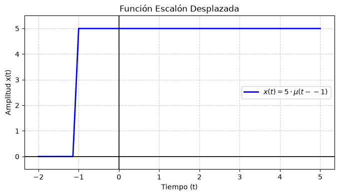
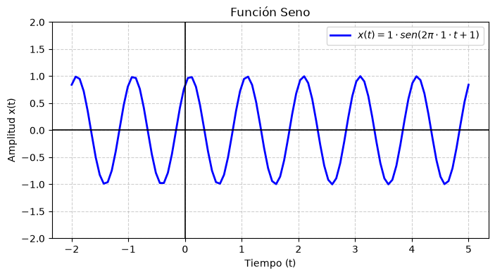
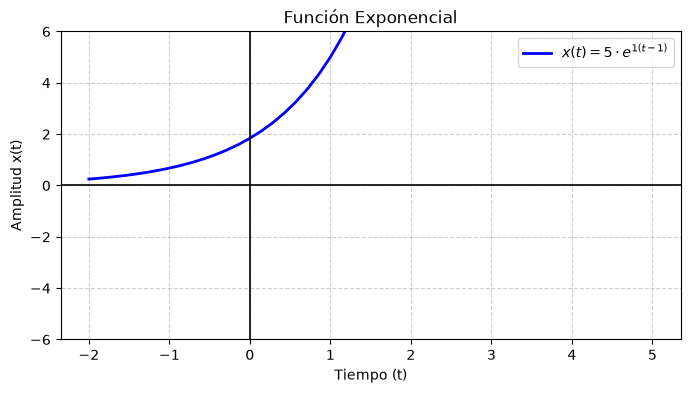
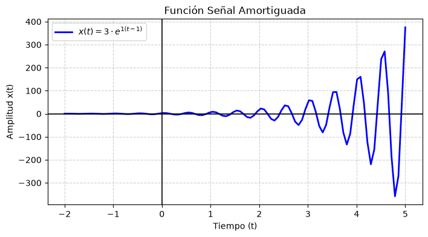
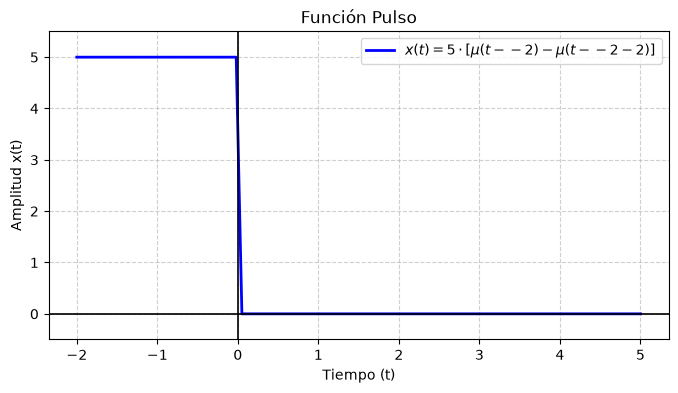

# Trabajo Práctico 2

## Punto 1: Implementación y visualización de funciones continuas

**Consigna.** Implementar en forma digital y visualizar las siguientes funciones continuas:

$$
x(t) = A\mu(t - t_0)
$$

$$
x(t) = A\sin(2\pi f_0 t + \theta)
$$

$$
x(t) = A e^{\alpha(t - t_0)}
$$

$$
x(t) = A\sin(2\pi f_0 t + \theta)e^{\alpha t}
$$

$$
p(t) = A[\mu(t - t_0) - \mu(t - t_0 - D)]
$$

Las funciones se evaluaron sobre un conjunto finito de valores de tiempo. En el notebook se usó un vector `t` y, para cada valor, se calculó el valor correspondiente de la señal.

### Función escalón

La función escalón se define como:

$$
x(t) = A\mu(t - t_0)
$$

donde:

$$
\mu(t - t_0) =
\begin{cases}
0, & t < t_0\\
1, & t \ge t_0
\end{cases}
$$

Esta señal vale cero antes del instante $t_0$ y luego toma el valor de la amplitud $A$. En la implementación se usaron:

$$
A = 5, \qquad t_0 = -1
$$

Con esos valores, la señal permanece en cero antes de $t = -1$ y después pasa a valer $5$.

### Función seno

La función senoidal se define como:

$$
x(t) = A\sin(2\pi f_0 t + \theta)
$$

En esta señal, $A$ representa la amplitud, $f_0$ la frecuencia y $\theta$ la fase. En la implementación se usaron:

$$
A = 1, \qquad f_0 = 1, \qquad \theta = 1
$$

La señal obtenida es periódica y oscila entre valores positivos y negativos. La frecuencia determina cuántos ciclos aparecen por unidad de tiempo, mientras que la fase desplaza la señal horizontalmente.

### Función exponencial

La función exponencial se define como:

$$
x(t) = A e^{\alpha(t - t_0)}
$$

En la implementación se usaron:

$$
A = 5, \qquad t_0 = 1, \qquad \alpha = 1
$$

Como el valor de $\alpha$ es positivo, la función crece a medida que aumenta el tiempo. Si $\alpha$ fuera negativo, la señal tendría un comportamiento decreciente.

### Señal amortiguada

La señal amortiguada combina una senoide con un factor exponencial:

$$
x(t) = A\sin(2\pi f_0 t + \theta)e^{\alpha t}
$$

En la implementación se usaron:

$$
A = 3, \qquad f_0 = 2, \qquad \alpha = 1
$$

La parte senoidal produce las oscilaciones y el factor exponencial modifica la amplitud con el tiempo. Para que la señal sea estrictamente amortiguada, el parámetro $\alpha$ debería ser negativo. Con $\alpha = 1$, el gráfico muestra una senoide con amplitud creciente.

### Función pulso

El pulso rectangular se define como:

$$
p(t) = A[\mu(t - t_0) - \mu(t - t_0 - D)]
$$

Esta señal se puede pensar como la diferencia entre dos escalones: el primero activa el pulso y el segundo lo desactiva. En la implementación se usaron:

$$
A = 5, \qquad t_0 = -2, \qquad D = 2
$$

Con esos valores, el pulso toma el valor $5$ durante un intervalo de duración $2$ y luego vuelve a cero.

