# MODELOS Y SIMULACIÓN - 2026

## Trabajo Práctico 5
### Punto 1: Ley del Enfriamiento de Newton

La Ley del Enfriamiento de Newton se modela mediante la ecuación diferencial:

```text
dT(t)/dt = -k (T - Tamb)
```

donde `T(t)` es la temperatura del objeto en el tiempo `t`, `Tamb` es la temperatura ambiente y `k` es la constante de enfriamiento.

En este trabajo tomamos el tiempo `t` en minutos y todas las temperaturas en grados Celsius. Por eso `k` tiene unidades de `min^-1`, ya que el producto `k*t` debe ser adimensional. Esto es importante porque el valor numérico de `k` depende de la unidad de tiempo elegida. Por ejemplo:

```text
0.5 min^-1 = 30 h^-1
```

Por lo tanto, comparar `k` con `1` no tiene significado físico si no se aclara la unidad de tiempo.

El modelo indica que la temperatura del objeto cambia según la diferencia entre su temperatura y la del ambiente. Si el objeto está más caliente que el ambiente, se enfría. Si está más frío, se calienta. En ambos casos, cuando `k > 0`, la temperatura tiende a `Tamb`.

---

## Resolución analítica

La ecuación es:

```text
dT/dt = -k (T - Tamb)
```

Haciendo el cambio:

```text
u = T - Tamb
```

queda:

```text
du/dt = -k u
```

Separando variables:

```text
du/u = -k dt
```

Integrando:

```text
ln |u| = -kt + C
```

Entonces:

```text
u(t) = C e^(-kt)
```

Como `u = T - Tamb`, se obtiene:

```text
T(t) = Tamb + C e^(-kt)
```

Si en `t = 0` la temperatura inicial es `T(0) = T0`, entonces:

```text
C = T0 - Tamb
```

Por lo tanto, la solución general es:

```text
T(t) = Tamb + (T0 - Tamb) e^(-kt)
```

Esta fórmula se usó para comparar los resultados numéricos obtenidos con `solve_ivp`.

---

## Caso base

Para el caso base se usaron:

```text
T0 = 90 °C
Tamb = 20 °C
k = 0.08 min^-1
```

La solución queda:

```text
T(t) = 20 + 70 e^(-0.08 t)
```

Algunos valores obtenidos fueron:

| Tiempo (min) | Temperatura T(t) |
|---:|---:|
| 0 | 90.0000 |
| 10 | 51.4532 |
| 30 | 26.3503 |
| 60 | 20.5761 |

Se observa que la temperatura baja rápido al principio, cuando la diferencia con el ambiente es grande. Después el descenso se vuelve más lento, porque el objeto ya está cerca de `Tamb = 20 °C`.

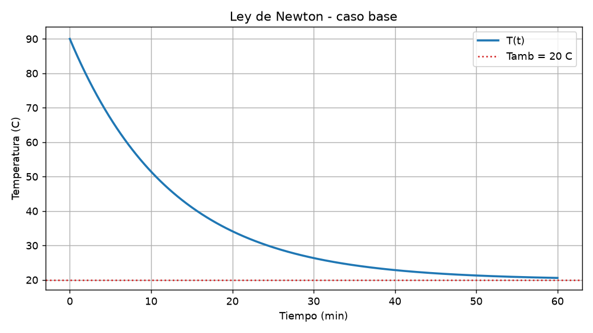

---

## Clasificación según el signo de k

La clasificación importante depende del signo de `k`:

- `k > 0`: la temperatura se acerca a `Tamb`. Es el comportamiento físico esperado.
- `k = 0`: la temperatura queda constante. Es un caso límite ideal de aislamiento perfecto.
- `k < 0`: la temperatura se aleja de `Tamb`. Matemáticamente se puede calcular, pero no representa enfriamiento real.

En el caso `k = 0`, se cumple:

```text
dT/dt = 0
```

Además, en la solución cerrada queda:

```text
e^0 = 1
```

Por eso:

```text
T(t) = T0
```

---

## Variación de k con Tamb fijo

En este análisis se mantuvo:

```text
T0 = 90 °C
Tamb = 20 °C
```

y se variaron distintos valores de `k`.

Para `k >= 0`, todas las curvas tienden al mismo equilibrio: `Tamb = 20 °C`. Lo que cambia es la rapidez. Cuanto mayor es `k`, más rápido se acerca el objeto a la temperatura ambiente.

También se incluyeron valores mayores a `1`, como `k = 1` y `k = 3`, para mostrar que no son una categoría física distinta. La curva tiene el mismo comportamiento general; simplemente se acerca al ambiente mucho más rápido.

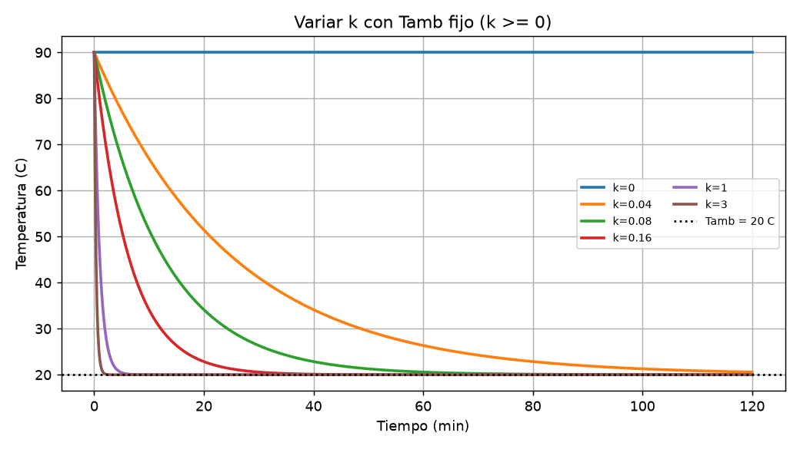

La constante de tiempo `1/k` ayuda a interpretar la rapidez del modelo. Después de un tiempo `1/k`, la diferencia con el ambiente se reduce aproximadamente al `37%` de la diferencia inicial.

Por ejemplo, si `k = 0.04`, entonces:

```text
1/k = 25 min
```

Esto significa que, después de `25 min`, la diferencia entre el objeto y el ambiente queda en aproximadamente un `37%` de la inicial.

---

## Caso k menor que cero

Cuando `k < 0`, el signo de la ecuación se invierte. Si el objeto está más caliente que el ambiente, en vez de enfriarse se calienta más. Si está más frío, en vez de calentarse se enfría más.

Esto significa que la diferencia con `Tamb` crece exponencialmente. El comportamiento es parecido al crecimiento de Malthus: la solución se aleja cada vez más del equilibrio.

Este caso no tiene sentido físico para enfriamiento, porque contradice la idea de que el calor fluye de lo caliente a lo frío.

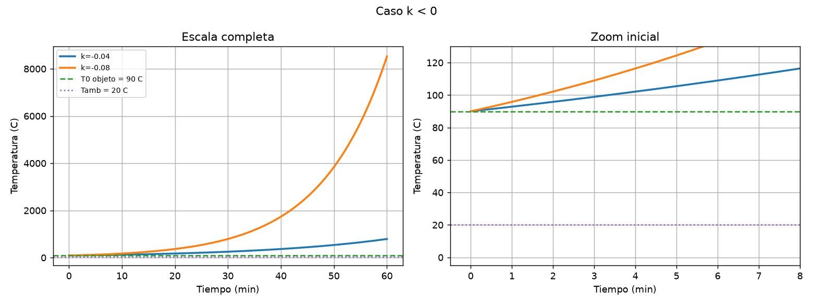

También se analizó el caso en que el objeto parte más frío que el ambiente, por ejemplo:

```text
T0 = 5 °C
Tamb = 20 °C
k = -0.08
```

En ese caso, la temperatura baja sin límite y llega a cruzar el cero absoluto `-273.15 °C`. Esto demuestra que el resultado numérico no representa una situación real.

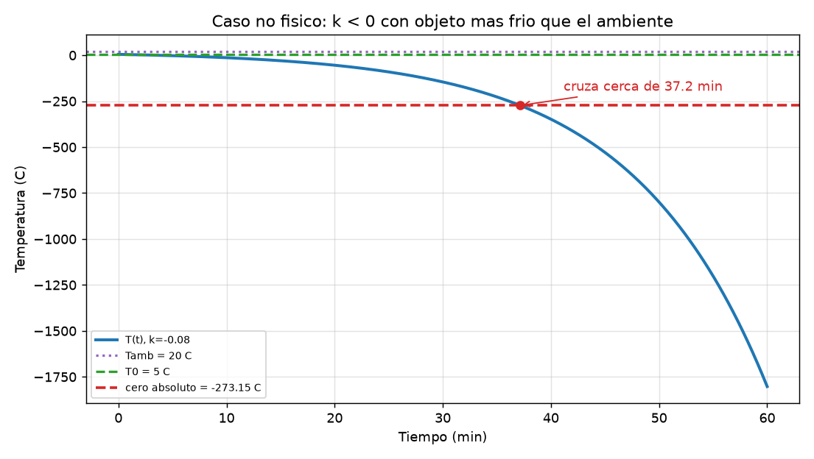

---

## Variación de Tamb con k fijo

En este análisis se dejó fijo:

```text
T0 = 90 °C
k = 0.08 min^-1
```

y se variaron distintos valores de temperatura ambiente:

```text
Tamb = -10, 0, 20, 40, 90, 110
```

Cada curva parte desde el mismo `T0`, pero tiende a un valor de equilibrio distinto. Ese equilibrio es justamente `Tamb`.

Si `Tamb < T0`, el objeto se enfría. Si `Tamb > T0`, el objeto se calienta. Si `Tamb = T0`, el objeto ya está en equilibrio desde el inicio y la temperatura queda constante.

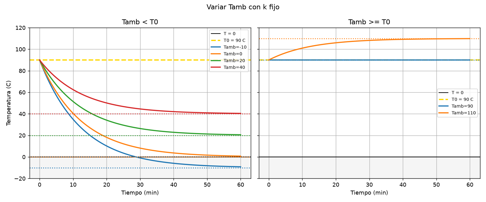

Este análisis muestra que `Tamb` define el equilibrio del modelo. Cambiar `Tamb` no cambia la forma exponencial de la solución, pero sí cambia el valor final al que tiende la temperatura.

---

## Variación de T0 con k y Tamb fijos

En este caso se mantuvo:

```text
Tamb = 20 °C
k = 0.08 min^-1
```

y se variaron los valores iniciales:

```text
T0 = -10, 30, 90, 1000
```

El objetivo fue analizar si la temperatura inicial cambia la rapidez del proceso. El resultado muestra que no cambia el ritmo relativo. Lo que cambia es el punto de partida y la diferencia inicial con el ambiente.

El tiempo para reducir a la mitad la diferencia con `Tamb` es:

```text
t_mitad = ln(2) / k
```

Con `k = 0.08`:

```text
t_mitad = 8.66 min
```

Ese tiempo es el mismo para todos los valores de `T0`.

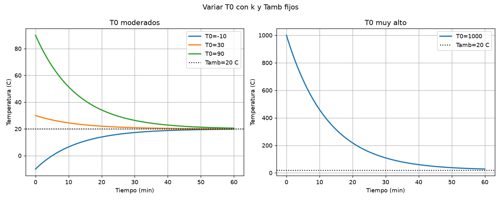

Por ejemplo:

- Si `T0 = 30 °C`, la diferencia inicial con `Tamb = 20 °C` es `10 °C`. Después de `8.66 min`, la diferencia queda en `5 °C`.
- Si `T0 = 90 °C`, la diferencia inicial es `70 °C`. Después de `8.66 min`, la diferencia queda en `35 °C`.
- Si `T0 = 1000 °C`, la diferencia inicial es `980 °C`. Después de `8.66 min`, la diferencia queda en `490 °C`.

El objeto que empieza en `1000 °C` baja muchos más grados por minuto que el que empieza en `30 °C`, pero también tiene mucha más diferencia para perder. En proporción, ambos pierden lo mismo en el mismo tiempo.

El caso `T0 = -10 °C` muestra el comportamiento contrario: el objeto se calienta hacia `Tamb = 20 °C`. La diferencia inicial es `30 °C`, y después de `8.66 min` queda cerca de `15 °C`.

Este análisis aporta una conclusión importante: `T0` solo define el punto de partida. No define el equilibrio ni el ritmo relativo del enfriamiento. El equilibrio lo define `Tamb`, y la rapidez la define `k`.

Esta idea es similar a la vida media del decaimiento radioactivo: la cantidad inicial no cambia el tiempo de reducción a la mitad. Ambos modelos son del mismo tipo exponencial.

En la práctica, si se mide experimentalmente el tiempo en que la diferencia con el ambiente se reduce a la mitad, se puede estimar:

```text
k = ln(2) / t_mitad
```

Luego, con ese valor de `k`, se puede predecir el enfriamiento para distintos valores de `T0`.

---

## Cambio de fase como caso raro

El caso `T0 = -10 °C` puede representar un objeto bajo cero colocado en un ambiente de `20 °C`. Si ese objeto fuera hielo, al llegar a `0 °C` no seguiría aumentando inmediatamente su temperatura. Durante la fusión se mantiene cerca de `0 °C`, porque el calor se usa para cambiar de estado y no para subir la temperatura. Ese calor se llama calor latente.

La Ley de Newton no representa esa meseta.

Lo mismo ocurre si el ambiente es negativo y el objeto contiene agua. Al llegar a `0 °C`, el agua se congela y también aparece una meseta. Por eso, aunque el modelo pueda calcular la curva, no siempre representa toda la física del problema.

---

## Casos especiales

También se resumieron distintos casos borde:

| Caso | Interpretación |
|---|---|
| `T0 = Tamb` | El objeto ya está en equilibrio. No hay cambio de temperatura. |
| `k = 0` | La temperatura queda constante porque `dT/dt = 0`. |
| `k < 0` | La temperatura se aleja de `Tamb`; no representa enfriamiento real. |
| `Tamb negativo` | Puede representar un freezer, pero el modelo ignora el congelamiento a `0 °C`. |
| Objeto más frío que el ambiente | El cuerpo se calienta hasta acercarse a `Tamb`. |

Estos casos ayudan a separar lo que la ecuación puede calcular de lo que tiene sentido físico.

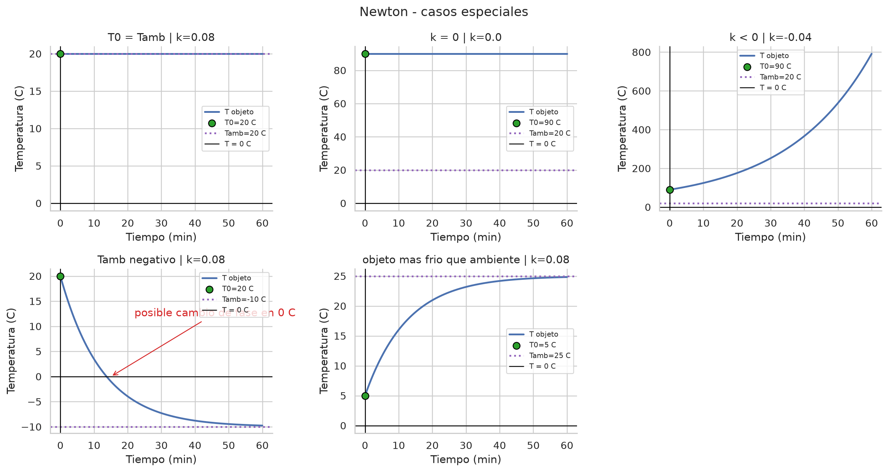

En los gráficos, el punto verde marca la temperatura inicial del objeto y la línea violeta punteada marca la temperatura ambiente. Esto permite ver rápido si el objeto se acerca a `Tamb`, si queda constante o si se aleja de forma no física.

---

## Supuestos del modelo

La Ley de Enfriamiento de Newton se apoya en varios supuestos:

- `Tamb` constante: el ambiente no se calienta ni se enfría por el objeto. Esto es razonable si el ambiente es mucho más grande que el objeto.
- `k` constante en el tiempo: se supone que la forma de intercambio de calor no cambia durante la simulación.
- Temperatura uniforme en todo el objeto: se representa el objeto con una sola temperatura `T(t)`.
- Sin cambios de fase: si hay hielo derritiéndose o agua congelándose, aparece una meseta en `0 °C` que el modelo no representa.
- Diferencias de temperatura moderadas: con diferencias grandes, como `T0 = 1000 °C`, puede dominar la radiación.

El caso `T0 = 1000 °C` es matemáticamente correcto para la ecuación, pero probablemente está fuera del rango de validez física del modelo. A temperaturas muy altas, la pérdida de calor por radiación puede ser dominante y no es proporcional a la diferencia de temperatura, sino que crece con la temperatura absoluta a la cuarta potencia.

Por eso, un resultado puede ser correcto para la ecuación y aun así no representar bien la realidad.

---


## Conclusión del punto 1

La Ley de Enfriamiento de Newton describe cómo un objeto se acerca a la temperatura ambiente cuando `k > 0`. El parámetro `Tamb` define el equilibrio, `k` define la rapidez del proceso, y `T0` solo define el punto de partida.

El signo de `k` es fundamental. Si `k > 0`, el modelo tiene sentido físico. Si `k = 0`, la temperatura queda constante. Si `k < 0`, la temperatura se aleja del ambiente y el resultado no representa enfriamiento real.

También se observó que el modelo solo es confiable dentro de sus supuestos: ambiente constante, `k` constante, temperatura uniforme, sin cambios de fase y diferencias de temperatura moderadas. Casos como `T0 = 1000 °C` o cambios de fase pueden ser correctos para la ecuación, pero no necesariamente para la realidad.

---

# Punto 2: Crecimiento poblacional de Malthus

## Planteo del modelo

El modelo de Malthus describe una población que crece o decrece a una tasa proporcional a la cantidad de individuos presentes:

```text
dP/dt = r P
```

Donde:

- `P(t)` es la población en el tiempo `t`.
- `P0` es la población inicial.
- `r` es la tasa neta de crecimiento.
- `t` se mide en años.
- `r` tiene unidades de `1/año`.

La tasa `r` representa la diferencia entre natalidad y mortalidad por individuo y por unidad de tiempo:

```text
r = tasa de natalidad - tasa de mortalidad
```

Por eso:

- Si `r > 0`, nacen más individuos de los que mueren y la población crece.
- Si `r = 0`, nacen y mueren en equilibrio y la población queda constante.
- Si `r < 0`, mueren más individuos de los que nacen y la población decrece.

Igual que ocurría con `k` en Newton, el valor numérico de `r` depende de la unidad de tiempo elegida. No es lo mismo expresar la tasa por año, por mes o por día.

---

## Resolución analítica

Partimos de:

```text
dP/dt = r P
```

Separamos variables:

```text
dP/P = r dt
```

Integramos:

```text
ln(P) = rt + C
```

Aplicando exponencial:

```text
P(t) = C e^(rt)
```

Usando la condición inicial `P(0) = P0`, queda:

```text
P(t) = P0 e^(rt)
```

Esta es una solución exponencial. La misma ecuación puede representar crecimiento o decrecimiento según el signo de `r`.

---

## Caso base

Se tomó como caso base:

```text
P0 = 100
r = 0.15 1/año
```

Con estos valores, la población crece exponencialmente. El tiempo de duplicación se calcula como:

```text
t_duplicación = ln(2) / r
```

Para `r = 0.15 1/año`:

```text
t_duplicación = 4.62 años
```

Esto significa que la población tarda aproximadamente `4.62 años` en multiplicarse por `2`.

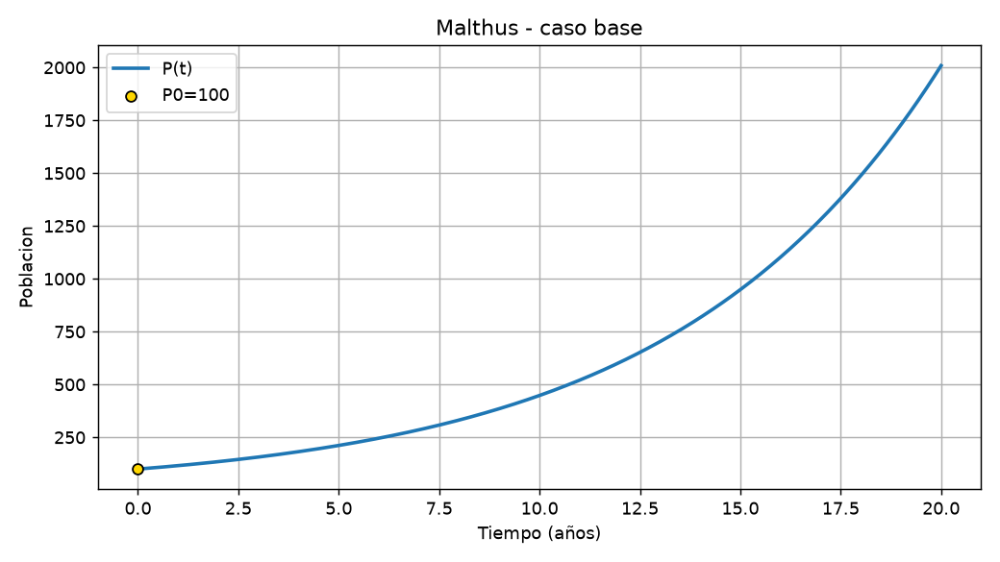

Algunos valores de referencia son:

| Tiempo | Población aproximada |
|---:|---:|
| `0 años` | `100.00` |
| `5 años` | `211.70` |
| `10 años` | `448.17` |
| `20 años` | `2008.55` |

La tabla muestra que el crecimiento no suma siempre la misma cantidad de individuos. Cada vez suma más, porque la velocidad depende de la población actual.

---

## Variación de `r` con `P0` fijo

En este análisis se mantuvo fija la población inicial:

```text
P0 = 100
```

y se probaron distintos valores de `r`.

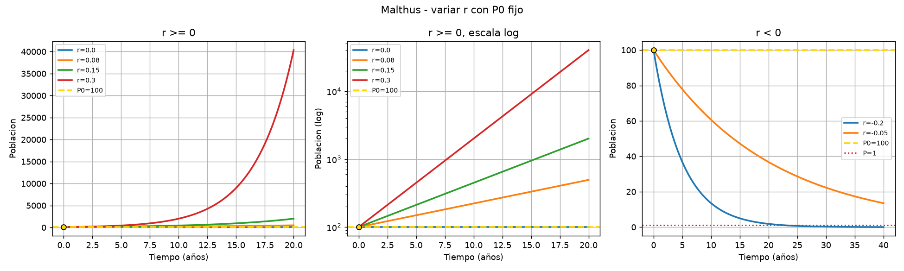

Cuando `r >= 0`, todas las curvas parten de la misma población inicial, pero crecen a distinta velocidad. Para `r = 0`, la población queda constante. Para valores positivos, cuanto mayor es `r`, más rápido crece la población.

El caso `r = 0.30` crece mucho más rápido que los demás. En `20 años`, partiendo de `P0 = 100`, llega a más de `40000` individuos. Por eso se separó el análisis y también se usó un gráfico con escala logarítmica.

En escala logarítmica, una exponencial se ve como una recta. La pendiente de esa recta depende de `r`: cuanto mayor es `r`, más inclinada aparece.

La columna `P después de 20 años` se usa solo como referencia comparativa. Los `20 años` son un horizonte elegido para comparar todos los casos en el mismo tiempo.

| `r` | Comportamiento | Tiempo de duplicación | Interpretación |
|---:|---|---|---|
| `0` | constante | no se duplica | No hay crecimiento. |
| `0.08` | crece | `8.66 años` | Crece lentamente. |
| `0.15` | crece | `4.62 años` | Crecimiento intermedio. |
| `0.30` | crece | `2.31 años` | Crecimiento muy rápido para este horizonte. |
| `< 0` | decrece | no se duplica | La población se acerca a `0`. |

Lo importante no es comparar `r` con `1`, sino mirar su signo y su unidad. El signo define si la población crece o decrece, y el valor de `r` define qué tan rápido ocurre.

---

## Variación de `P0` con `r` fijo

En este bloque se dejó fija la tasa:

```text
r = 0.15 1/año
```

y se cambiaron las poblaciones iniciales:

```text
P0 = 1, 50, 100, 1000
```

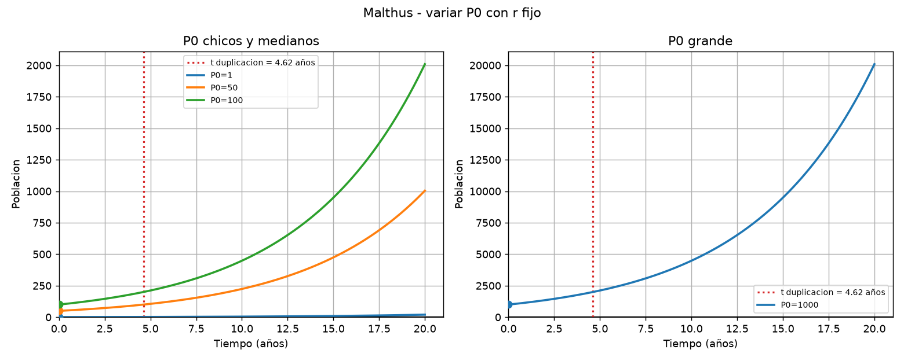

El resultado muestra que cambiar `P0` solo cambia la escala de la curva. Todas las poblaciones se duplican en el mismo tiempo:

```text
ln(2) / 0.15 = 4.62 años
```

Por ejemplo:

| `P0` inicial | Población después de `4.62 años` | Interpretación |
|---:|---:|---|
| `1` | `2` | Se duplica. |
| `50` | `100` | Se duplica. |
| `100` | `200` | Se duplica. |
| `1000` | `2000` | Se duplica. |

Esto ocurre porque la velocidad de crecimiento es proporcional a la población actual. Una población grande suma más individuos por año, pero también necesita sumar más individuos para duplicarse. En proporción, todas crecen al mismo ritmo.

Entonces:

- `r` define el ritmo relativo de crecimiento.
- `P0` define el punto de partida.
- El tiempo de duplicación no depende de `P0`, sino de `r`.

Esta es la misma idea que apareció en Newton con el tiempo mitad: cambiar el valor inicial cambia los valores absolutos, pero no el tiempo característico del proceso.

El caso `P0 = 1` sirve como advertencia. Matemáticamente el modelo predice crecimiento, pero biológicamente un solo individuo no necesariamente puede reproducirse. El modelo trata la población como una cantidad continua, no como individuos discretos.

---

## Casos especiales

También se analizaron casos borde para ver cuándo la ecuación calcula un resultado pero la interpretación deja de ser realista.

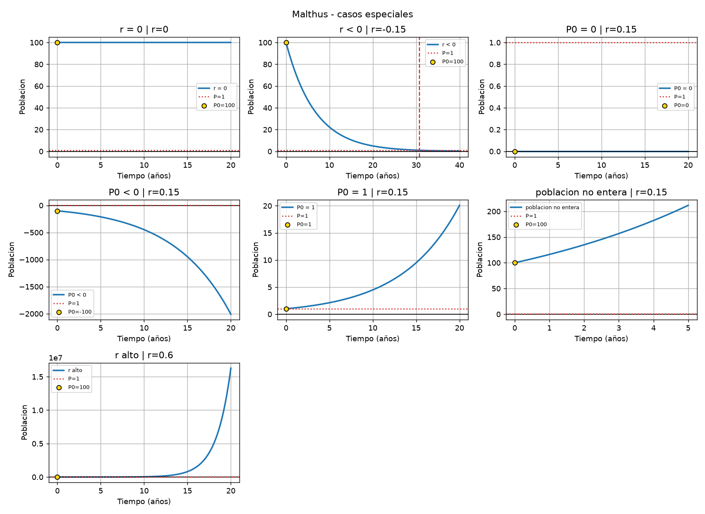

| Caso | Interpretación |
|---|---|
| `r = 0` | La población queda constante. |
| `r < 0` | La población decrece hacia `0`, pero el modelo nunca llega exactamente a `0`. |
| `P0 = 0` | La población queda en `0`; no aparece población de la nada. |
| `P0 < 0` | No tiene sentido físico ni biológico, porque no existe población negativa. |
| `P0 = 1` | El modelo predice crecimiento, pero la interpretación biológica es débil. |
| Población no entera | Pueden aparecer valores como `211.7` individuos; es una aproximación continua. |
| `r` alto | El crecimiento se vuelve explosivo si se mantiene el modelo por mucho tiempo. |

Para el caso `r < 0`, la ecuación se acerca a cero sin alcanzarlo. Sin embargo, una población real no puede tener `0.24` individuos. Por eso se puede tomar como criterio práctico que, cuando `P < 1`, la población ya se extinguió.

Con:

```text
P0 = 100
r = -0.15 1/año
```

el tiempo para bajar de `1` individuo es:

```text
t = ln(1/P0) / r = 30.70 años
```

Este caso muestra una limitación importante: el modelo continuo puede seguir calculando valores positivos menores que `1`, pero esos valores no representan individuos reales.

La población no entera tiene una interpretación parecida. Un resultado como `211.7` individuos no significa que existan `0.7` individuos, sino que el modelo funciona como aproximación promedio. Esa aproximación tiene más sentido cuando la población es grande.

---

## Supuestos del modelo

El modelo de Malthus supone:

- Recursos y espacio ilimitados.
- `r` constante en el tiempo.
- Sin migración.
- Población continua y suficientemente grande.

El supuesto más fuerte es el de recursos ilimitados. En una población real, el alimento, el espacio y otros recursos imponen límites. Por eso el crecimiento exponencial puede servir en el corto plazo, pero no indefinidamente.

El modelo logístico de Verhulst corrige esta limitación agregando una capacidad máxima del ambiente. Ese modelo no se implementó en este punto, pero permite representar que el crecimiento se frena cuando la población se acerca al límite de recursos.

Conocer estos supuestos permite decidir cuándo confiar en el resultado y cuándo tomarlo solo como una idealización matemática.

---

## Conclusión del punto 2

El modelo de Malthus muestra que `r` es el parámetro principal. Su signo define si la población crece, queda constante o decrece, y su valor define qué tan rápido ocurre el cambio.

La población inicial `P0` solo escala la curva. Si `r` queda fijo, cambiar `P0` cambia los valores absolutos, pero no cambia el tiempo de duplicación.

El modelo es útil para describir crecimiento o decrecimiento en poblaciones grandes y en intervalos cortos. Para poblaciones pequeñas, valores no enteros, falta de recursos o tiempos muy largos, deja de representar bien la realidad.

El decaimiento radioactivo del punto 3 es la misma ecuación con tasa negativa:

```text
r = -lambda
```

---

# Punto 3: Decaimiento radioactivo

## Planteo del modelo

El decaimiento radioactivo se modela con una ecuación diferencial donde la cantidad de sustancia disminuye a una velocidad proporcional a la cantidad presente:

```text
dN/dt = -lambda N
```

Donde:

- `N(t)` es la cantidad de sustancia radioactiva en el tiempo `t`.
- `N0` es la cantidad inicial.
- `lambda` es la constante de desintegración.
- `t` se mide en años.
- `lambda` tiene unidades de `1/año`.

Si `lambda > 0`, la cantidad disminuye hacia `0`. La vida media es:

```text
t_vida_media = ln(2) / lambda
```

La vida media indica cuánto tarda la sustancia en reducirse a la mitad.

Ejemplo real: el carbono 14 tiene una vida media aproximada de `5730 años`. Entonces:

```text
lambda = ln(2) / 5730 = 0.00012097 1/año
```

Este modelo es la misma ecuación que Malthus con tasa negativa:

```text
r = -lambda
```

Por eso, si se usa `lambda < 0`, el signo se invierte y aparece crecimiento exponencial. Matemáticamente se puede calcular, pero no tiene sentido físico para radioactividad.

---

## Resolución analítica

Partimos de:

```text
dN/dt = -lambda N
```

Separamos variables:

```text
dN/N = -lambda dt
```

Integramos:

```text
ln(N) = -lambda t + C
```

Aplicando exponencial:

```text
N(t) = C e^(-lambda t)
```

Usando la condición inicial `N(0) = N0`, queda:

```text
N(t) = N0 e^(-lambda t)
```

---

## Caso base

Se tomó como caso base:

```text
N0 = 800
lambda = 0.12 1/año
```

Con estos valores:

```text
vida media = ln(2) / 0.12 = 5.78 años
```

Esto significa que cada `5.78 años` queda la mitad de la cantidad que había antes.

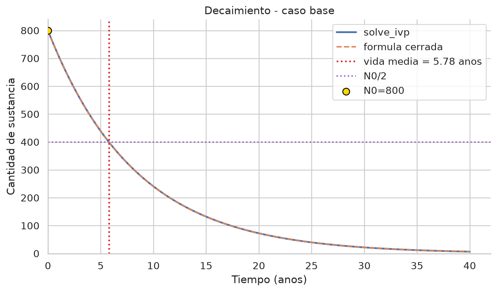

Algunos valores de referencia son:

| Tiempo | Cantidad aproximada |
|---:|---:|
| `0 años` | `800` |
| `5.78 años` | `400` |
| `11.55 años` | `200` |
| `17.33 años` | `100` |

La cantidad baja rápido al principio porque hay mucha sustancia disponible para desintegrarse. Después sigue bajando, pero cada vez queda menos cantidad absoluta.

---

## Variación de `lambda` con `N0` fijo

En este análisis se mantuvo fija la cantidad inicial:

```text
N0 = 800
```

y se probaron distintos valores de `lambda`.

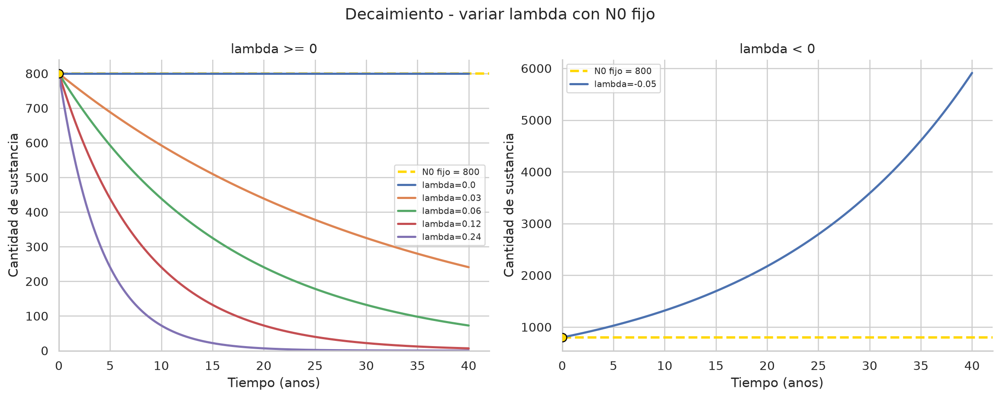

Cuando `lambda = 0`, no hay decaimiento y la cantidad queda constante. Cuando `lambda > 0`, la sustancia decae hacia `0`. Cuanto mayor es `lambda`, más rápida es la caída y menor es la vida media.

La tabla del notebook se mejoró para evitar valores `NaN`. En los casos donde no corresponde hablar de vida media, se indica como `no aplica`.

| `lambda` | Comportamiento | Vida media | Interpretación |
|---:|---|---|---|
| `0` | constante | no aplica | No hay decaimiento. |
| `0.03` | decae | `23.10 años` | Decae lentamente. |
| `0.06` | decae | `11.55 años` | Decae más rápido. |
| `0.12` | decae | `5.78 años` | Caso base. |
| `0.24` | decae | `2.89 años` | Decae muy rápido. |
| `< 0` | crece | no aplica | No tiene sentido físico para radioactividad. |

El caso `lambda < 0` se graficó aparte porque se transforma en crecimiento exponencial. Es el mismo fenómeno matemático que en Malthus con `r > 0`, pero no representa decaimiento radioactivo.

---

## Variación de `N0` con `lambda` fijo

Ahora se dejó fija la constante:

```text
lambda = 0.12 1/año
```

y se cambiaron las cantidades iniciales:

```text
N0 = 10, 50, 400, 800
```

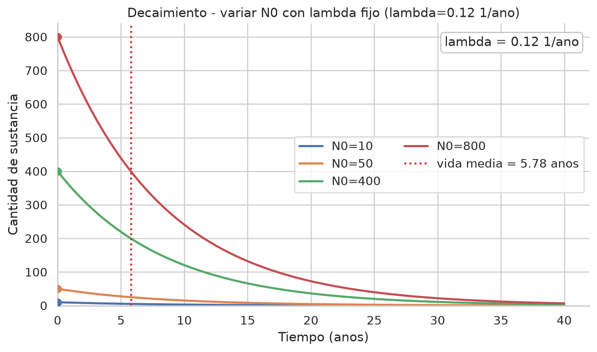

El gráfico muestra que `N0` solo cambia la escala de la curva. Todas las sustancias tardan lo mismo en reducirse a la mitad, porque la vida media depende de `lambda`, no de la cantidad inicial.

Con `lambda = 0.12 1/año`, la vida media es:

```text
ln(2) / 0.12 = 5.78 años
```

Por ejemplo:

| `N0` inicial | Cantidad en una vida media | Interpretación |
|---:|---:|---|
| `10` | `5` | Se reduce a la mitad. |
| `50` | `25` | Se reduce a la mitad. |
| `400` | `200` | Se reduce a la mitad. |
| `800` | `400` | Se reduce a la mitad. |

Esto es equivalente a lo visto en Malthus con el tiempo de duplicación y en Newton con el tiempo mitad. El valor inicial cambia los valores absolutos, pero no el tiempo característico del proceso.

---

## Casos especiales

También se analizaron casos borde para distinguir el cálculo matemático de la interpretación física.

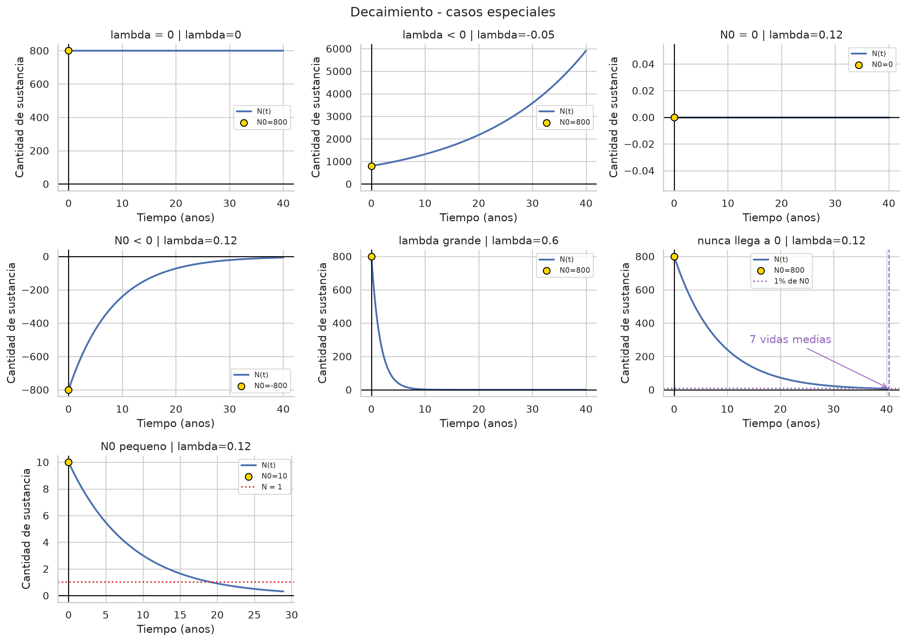

| Caso | Interpretación |
|---|---|
| `lambda = 0` | La cantidad queda constante. |
| `lambda < 0` | Aparece crecimiento exponencial; no representa radioactividad. |
| `N0 = 0` | La cantidad queda en `0`; no aparece sustancia de la nada. |
| `N0 < 0` | No tiene sentido físico, porque no existe cantidad negativa de átomos. |
| `lambda grande` | El decaimiento ocurre muy rápido. |
| Nunca llega a `0` | El modelo se acerca a `0`, pero no lo alcanza exactamente. |
| `N0` pequeño | Puede dar fracciones de átomos, lo cual no tiene sentido literal. |

Para ver cuándo queda menos del `1%` de la cantidad inicial, se usó:

```text
(1/2)^n < 0.01
```

Esto ocurre después de aproximadamente `7` vidas medias. Con `lambda = 0.12 1/año`, eso equivale a:

```text
7 * 5.78 = 40.43 años
```

Aunque el modelo nunca llega exactamente a `0`, después de varias vidas medias la cantidad puede volverse muy chica.

El caso `N0 = 10` muestra otra limitación. El modelo puede predecir valores como `0.3` átomos, pero eso no tiene sentido físico literal. En la realidad, el decaimiento de pocos átomos es aleatorio. El modelo exponencial describe bien grandes cantidades de átomos como un promedio estadístico.

---

## Supuestos del modelo

El modelo de decaimiento radioactivo supone:

- Gran cantidad de átomos.
- `lambda` constante, propia del material.
- `lambda` no depende de la temperatura ni de la presión.
- No hay producción de nueva sustancia.

Estos supuestos son importantes porque el modelo no sigue átomo por átomo. Describe el comportamiento promedio de una muestra grande.

---

## Conclusión del punto 3

En el decaimiento radioactivo, `lambda` define la velocidad de desaparición de la sustancia y determina la vida media `ln(2)/lambda`. Cuanto mayor es `lambda`, menor es la vida media.

`N0` solo escala la curva: cambiar la cantidad inicial cambia los valores absolutos, pero no cambia la vida media.

El modelo es confiable para grandes cantidades de átomos y como descripción estadística. Para cantidades pequeñas, puede dar fracciones de átomos, y ahí deja de ser una representación literal.

La ecuación se puede resolver para cualquier valor de `lambda`, pero solo representa decaimiento radioactivo cuando `lambda > 0`.

---

# Punto 4.a: Representación en Xcos

## Sistema planteado

El sistema pedido en el inciso 4.a es:

```text
dx/dt = x + 2y
dy/dt = -5x + 2y
```

El objetivo fue representarlo mediante un diagrama en bloques en Xcos. Para eso se usó un integrador para cada variable:

- La salida del primer integrador representa `x(t)`.
- La salida del segundo integrador representa `y(t)`.

Luego se construyó cada derivada con ganancias y sumadores.

Para la primera ecuación:

```text
dx/dt = x + 2y
```

se suman dos señales: `x(t)` multiplicada por `1` e `y(t)` multiplicada por `2`.

Para la segunda ecuación:

```text
dy/dt = -5x + 2y
```

se suman `x(t)` multiplicada por `-5` e `y(t)` multiplicada por `2`.

De esta forma, el diagrama reproduce directamente el sistema de ecuaciones diferenciales.

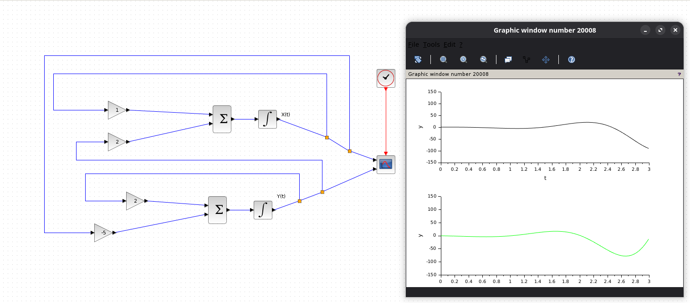

En la captura se observa el diagrama de bloques a la izquierda y la salida gráfica de la simulación a la derecha. Las dos curvas muestran la evolución temporal de `x(t)` e `y(t)`.


---

# Punto 4.b: Representación en Xcos

## Sistema planteado

El sistema pedido en el inciso 4.b es:

```text
dx/dt = -2x
dy/dt = -3y
```

En este caso, las ecuaciones están desacopladas. Esto significa que la evolución de `x(t)` no depende de `y(t)`, y la evolución de `y(t)` no depende de `x(t)`.

Para representarlo en Xcos se usó un integrador para cada variable:

- La salida del primer integrador representa `x(t)`.
- La salida del segundo integrador representa `y(t)`.

La derivada de `x` se construyó realimentando `x(t)` con una ganancia `-2`:

```text
dx/dt = -2x
```

La derivada de `y` se construyó realimentando `y(t)` con una ganancia `-3`:

```text
dy/dt = -3y
```

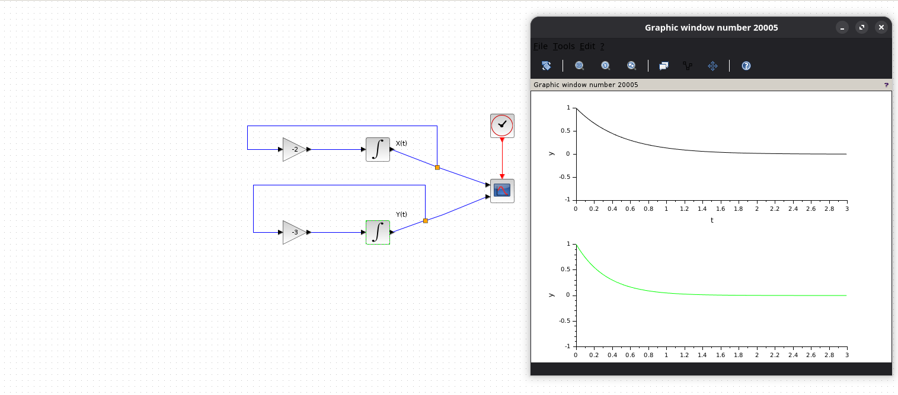

En la captura se observa que cada variable tiene su propio lazo de realimentación. No hay conexiones cruzadas entre `x(t)` e `y(t)`, porque el sistema no mezcla ambas variables.

Las gráficas muestran que tanto `x(t)` como `y(t)` disminuyen y se acercan a `0`. Además, `y(t)` cae más rápido porque su coeficiente es `-3`, mientras que el de `x(t)` es `-2`.

## Conclusión del punto 4.b

El inciso 4.b representa dos decaimientos exponenciales independientes. Xcos permite verlo directamente: cada integrador tiene una realimentación negativa, y eso hace que ambas variables tiendan a `0`.

La diferencia con el punto 4.a es que acá no hay acoplamiento entre las variables. Cada ecuación se puede interpretar por separado.

---

# Punto 4.c: Representación en Xcos

## Sistema planteado

El sistema pedido en el inciso 4.c es:

```text
dx/dt = -3x + 2y
dy/dt = -x
```

En este caso, las variables vuelven a estar acopladas. La ecuación de `x(t)` depende de `x(t)` y de `y(t)`, mientras que la ecuación de `y(t)` depende de `x(t)`.

Para representarlo en Xcos se usó un integrador para cada variable:

- La salida del primer integrador representa `x(t)`.
- La salida del segundo integrador representa `y(t)`.

La derivada de `x` se construyó sumando dos señales:

```text
-3x + 2y
```

Por eso, en el diagrama aparecen una ganancia `-3` aplicada a `x(t)` y una ganancia `2` aplicada a `y(t)`.

La derivada de `y` se construyó con:

```text
-x
```

Por eso `x(t)` se realimenta hacia el integrador de `y(t)` con una ganancia `-1`.

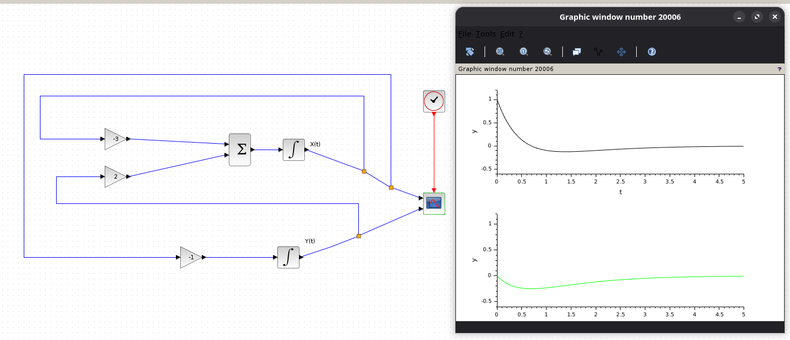

En la simulación se observa que `x(t)` baja desde `1`, cruza levemente el cero y llega aproximadamente a `-0.12` cerca de `t = 1.4`. Luego vuelve lentamente hacia `0`.

También se observa que `y(t)` baja hasta aproximadamente `-0.25` cerca de `t = 0.7`, y después vuelve hacia `0`.

El sistema es estable porque las dos variables tienden a `0`. No presenta una oscilación sostenida: `x(t)` cruza el cero una sola vez y luego se acerca al equilibrio sin alternar repetidamente de signo.

La relación entre las variables se ve en la segunda ecuación. Como:

```text
dy/dt = -x
```

mientras `x(t)` es positiva, `y(t)` disminuye. Después, cuando `x(t)` se reduce y cambia de signo, `y(t)` deja de bajar y comienza a volver hacia `0`.

## Comparación con el punto 4.a

El punto 4.a y el punto 4.c son sistemas acoplados, porque en ambos una variable influye sobre la otra. Sin embargo, el comportamiento no es el mismo.

En el punto 4.a las curvas tenían un comportamiento más oscilatorio y crecían en amplitud. En cambio, en el punto 4.c las curvas decaen hacia `0`.

La diferencia está en los coeficientes del sistema. En el punto 4.c aparece una realimentación negativa fuerte sobre `x(t)`, dada por el término `-3x`. Ese término frena el crecimiento de `x(t)` y ayuda a que el sistema se estabilice.

## Conclusión del punto 4.c

El inciso 4.c muestra un sistema acoplado pero estable. Las variables se influyen entre sí, pero la dinámica total hace que ambas tiendan a `0`.

Esto muestra que no alcanza con saber si un sistema está acoplado o no. También importa el signo y el valor de los coeficientes, porque ellos determinan si las soluciones crecen, oscilan o decaen.

---

# Punto 4.d: Representación en Xcos

## Sistema planteado

El sistema pedido en el inciso 4.d es:

```text
dx/dt = 10x - 18y
dy/dt = 6x - 11y
```

Este sistema también está acoplado. La evolución de `x(t)` depende de `x(t)` y de `y(t)`, y lo mismo ocurre con `y(t)`.

Para representarlo en Xcos se usó un integrador para cada variable:

- La salida del primer integrador representa `x(t)`.
- La salida del segundo integrador representa `y(t)`.

La derivada de `x` se construyó sumando:

```text
10x - 18y
```

Por eso, en el diagrama aparecen una ganancia `10` aplicada a `x(t)` y una ganancia `-18` aplicada a `y(t)`.

La derivada de `y` se construyó sumando:

```text
6x - 11y
```

Por eso aparecen una ganancia `6` aplicada a `x(t)` y una ganancia `-11` aplicada a `y(t)`.

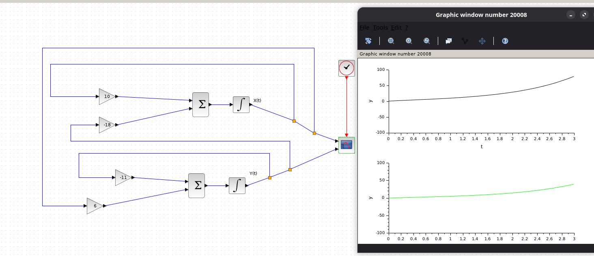

En la simulación se observa que las dos variables crecen con el tiempo. `x(t)` aumenta más rápido y llega a valores cercanos a `80` hacia el final del intervalo mostrado, mientras que `y(t)` también aumenta, aunque con menor amplitud.

Esto indica que el sistema no tiende al equilibrio `0`. Aunque algunos coeficientes son negativos, la combinación de todos los términos genera una dirección de crecimiento.

## Interpretación para la defensa

Este sistema es inestable. Una forma de verlo es que, ante las condiciones iniciales usadas, las soluciones se alejan del origen en lugar de acercarse a `0`.

La presencia de términos negativos no garantiza estabilidad. Lo importante es el efecto conjunto de todos los coeficientes del sistema.

Comparado con el punto 4.c, ambos sistemas están acoplados, pero el comportamiento es opuesto. En el 4.c las variables decaían hacia `0`; en el 4.d las variables crecen y se alejan del equilibrio.

## Conclusión del punto 4.d

El inciso 4.d muestra un sistema acoplado e inestable. La simulación en Xcos permite ver directamente que las variables no se estabilizan, sino que aumentan con el tiempo.

Esto refuerza la idea de que el comportamiento del sistema depende de la combinación completa de coeficientes, no solo de que haya términos positivos o negativos por separado.

---

# Punto 4.e: Representación en Xcos

## Sistema planteado

El sistema pedido en el inciso 4.e es:

```text
dx/dt = -y
dy/dt = x - 2y
```

Este sistema está acoplado, porque la derivada de `x(t)` depende de `y(t)` y la derivada de `y(t)` depende tanto de `x(t)` como de `y(t)`.

Para representarlo en Xcos se usó un integrador para cada variable:

- La salida del primer integrador representa `x(t)`.
- La salida del segundo integrador representa `y(t)`.

La derivada de `x` se construyó con:

```text
-y
```

Por eso, la señal `y(t)` se conecta hacia el integrador de `x(t)` pasando por una ganancia `-1`.

La derivada de `y` se construyó sumando:

```text
x - 2y
```

Por eso, en el diagrama aparecen una ganancia `1` aplicada a `x(t)` y una ganancia `-2` aplicada a `y(t)`.

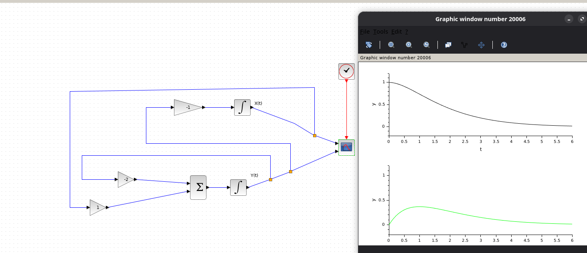

En la simulación se observa que `x(t)` baja de manera suave desde su valor inicial y se acerca a `0`. La variable `y(t)` primero aumenta, alcanza un máximo y después también baja hacia `0`.

Esto muestra un comportamiento estable: ninguna variable crece sin límite y ambas terminan acercándose al equilibrio.

## Interpretación para la defensa

Aunque el sistema está acoplado, la combinación de coeficientes produce un decaimiento amortiguado. No aparece una oscilación sostenida ni un crecimiento explosivo.

La variable `y(t)` crece al principio porque en su ecuación aparece el término positivo `x`. Pero al mismo tiempo tiene el término `-2y`, que actúa como freno. Por eso, después de alcanzar un máximo, `y(t)` empieza a disminuir.

## Conclusión del punto 4.e

El inciso 4.e muestra un sistema acoplado estable. Las variables se afectan entre sí, pero el término `-2y` amortigua la dinámica y hace que las soluciones tiendan a `0`.

Comparado con el punto 4.d, este sistema no se aleja del equilibrio. La diferencia está en cómo se combinan los coeficientes de realimentación.

---

# Punto 4.f: Representación en Xcos

## Sistema planteado

El sistema pedido en el inciso 4.f es:

```text
dx/dt = y
dy/dt = -y
```

En este caso, `y(t)` evoluciona de manera independiente, porque su derivada solo depende de `y(t)`. En cambio, `x(t)` depende de `y(t)`.

Para representarlo en Xcos se usó un integrador para cada variable:

- La salida del primer integrador representa `x(t)`.
- La salida del segundo integrador representa `y(t)`.

La derivada de `x` se construyó con:

```text
y
```

Por eso, la salida `y(t)` se conecta hacia el integrador de `x(t)` con una ganancia `1`.

La derivada de `y` se construyó con:

```text
-y
```

Por eso, `y(t)` se realimenta hacia su propio integrador con una ganancia `-1`.

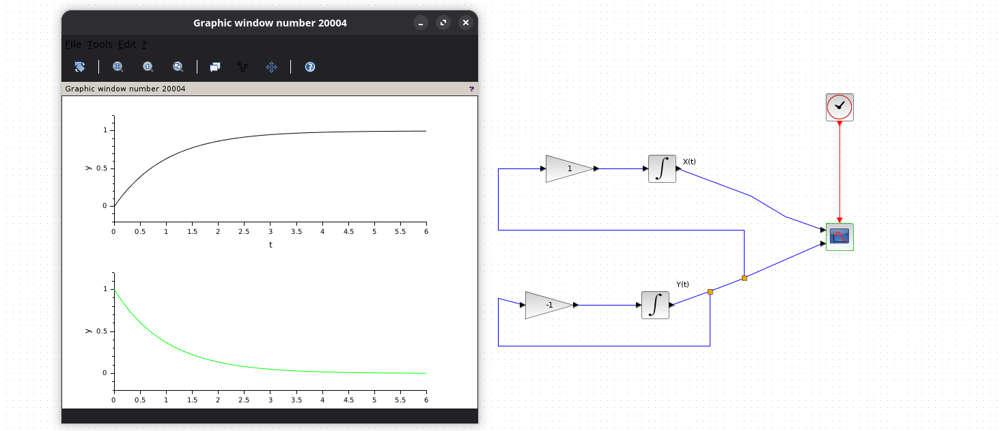

En la simulación se observa que `y(t)` decae hacia `0`. Al mismo tiempo, `x(t)` aumenta al principio y luego se acerca a un valor constante.

Esto ocurre porque `dx/dt = y`. Mientras `y(t)` es positiva, `x(t)` crece. Pero como `y(t)` se va apagando, el crecimiento de `x(t)` se frena hasta quedar prácticamente constante.

## Interpretación para la defensa

Este caso es distinto de los anteriores porque las dos variables no necesariamente tienden a `0`. La variable `y(t)` sí tiende a `0`, pero `x(t)` tiende a un valor constante.

Eso pasa porque cuando `y(t)` llega a `0`, entonces:

```text
dx/dt = 0
```

Por lo tanto, `x(t)` deja de cambiar. El equilibrio no es solo el punto `(0, 0)`, sino cualquier estado con `y = 0`.

## Conclusión del punto 4.f

El inciso 4.f muestra un sistema donde una variable decae y la otra acumula el efecto de esa variable. `y(t)` se apaga, mientras que `x(t)` se estabiliza en un valor constante.

Esto permite ver que un sistema puede estabilizarse sin que todas sus variables terminen necesariamente en `0`.

---

# Resumen del punto 4

En todos los incisos se usó la misma idea de construcción en Xcos: un integrador por cada variable del sistema, y ganancias y sumadores para armar las derivadas.

Lo que cambia entre los sistemas son los coeficientes. Esos coeficientes determinan si las soluciones crecen, decaen, oscilan o se estabilizan.

| Sistema | Tipo | Comportamiento |
|---|---|---|
| (a) | Acoplado | Oscila y crece: inestable. |
| (b) | Desacoplado | Decae sin oscilar: estable, con dos decaimientos independientes. |
| (c) | Acoplado | Decae sin oscilar: estable. |
| (d) | Acoplado | Crece sin oscilar: inestable en general. Si se arranca exactamente en la dirección `(3, 2)`, decae hacia `0`, pero esa es una condición especial. |
| (e) | Acoplado | Decae sin oscilar, en el límite de oscilar: estable. |
| (f) | Acoplado parcial | `y(t)` decae y `x(t)` se estabiliza en un valor fijo: hay infinitos equilibrios con `y = 0`. |

La idea general es que el diagrama en bloques traduce directamente las ecuaciones diferenciales. Las condiciones iniciales cambian la escala o la trayectoria particular, pero la estabilidad depende principalmente de los coeficientes del sistema.

Por eso, dos sistemas pueden estar acoplados y aun así comportarse de forma muy distinta: algunos se estabilizan, otros oscilan y otros crecen sin límite.
